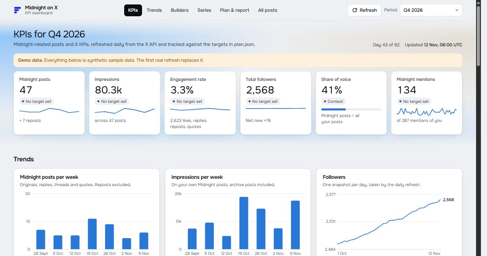

# Midnight on X: KPI dashboard kit

Your own self-updating KPI dashboard for Midnight-related posts on X, hosted free on GitHub Pages.

- **Every day it reads your posts** from the X API, picks out the Midnight-related ones and updates the page by itself.
- **KPIs against your targets:** Midnight posts, impressions, engagement rate, followers, share of voice and mentions, plus an optional focus area (a region or topic) with its own share of your posts.
- **Trends, top posts, posting days, content mix and series**, with a searchable list of all your posts.
- **Plan and report:** quarterly targets, a content calendar and a summary you can copy into a report.
- **Builders:** showcase people you have helped get started, with their links and a picture of their website.

Setup takes about 20 minutes, all in your browser. You don't need to install anything.



---

## What you need

| | |
|---|---|
| A **GitHub account** | Free. [Sign up](https://github.com/signup) if you don't have one. |
| Your **X account** | The account whose posts you want to track. |
| An **X developer account with credit** | The X API is pay-per-use, with no free tier. A few dollars covers setup and the first month (see [Costs](#costs)). |

---

## Set up in 5 steps

### 1. Make your copy

1. At the top of this page, click **Use this template** → **Create a new repository**.
2. **Owner:** you. **Repository name:** anything, for example `midnight-dashboard`.
3. Choose **Public**. Free GitHub Pages only publishes public repositories, so your dashboard and its data will be public.
4. Click **Create repository**.

Do the remaining steps in **your new repository**, not on this page.

### 2. Turn on GitHub Pages

1. In your repository: **Settings** → **Pages**.
2. Under *Build and deployment*, **Source:** *Deploy from a branch*. **Branch:** `main`, folder `/ (root)`. Click **Save**.

Your dashboard's address is **`https://<your-github-name>.github.io/<repository-name>/`**. It shows sample data (with a "Demo data" banner) until step 5.

### 3. Get your X API keys

Sign in to the [X Developer Console](https://console.x.com) **with the X account you want to track**. This matters: X charges the low "own posts" rate only when the app's owner reads their own posts.

1. **Billing:** buy a small amount of credit (for example $5) and **set a monthly spending limit** (for example $10).
2. **Create a Project, then an App inside it.** An app that isn't inside a Project gets error 403.
3. App permissions: **Read** is enough.
4. In the app's **Keys and tokens**:
   - copy the **API Key** and **API Key Secret**;
   - generate an **Access Token** and **Access Token Secret** for your account and copy them.

You now have four keys. Keep them private: don't paste them into any file, chat or post.

### 4. Add the four keys to GitHub

In your repository: **Settings** → **Secrets and variables** → **Actions** → **New repository secret**. Do this four times. Type the name exactly as shown in **Name**, and paste the key in **Secret**:

| Name | Secret |
|---|---|
| `X_API_KEY` | API Key |
| `X_API_SECRET` | API Key Secret |
| `X_ACCESS_TOKEN` | Access Token |
| `X_ACCESS_TOKEN_SECRET` | Access Token Secret |

GitHub stores the keys encrypted, and only your repository's workflows can use them.

### 5. Run the setup

1. In your repository, open the **Actions** tab. If GitHub asks, click **I understand my workflows, go ahead and enable them**.
2. Click **Set up the dashboard** in the list on the left, then **Run workflow** (on the right).
3. Fill in the form:

   | Field | What to put |
   |---|---|
   | **Your role** | Shown under the title, for example `Nightforce Leader`. |
   | **Focus area** *(optional)* | A region or topic you want to track, for example `Nigeria`, `Lagos`, `DeFi` or `Education`. Leave it empty to skip. |
   | **Focus words** *(optional)* | Words that mark a post as being about your focus area, comma-separated: cities, hashtags, a flag emoji. The focus area's own name and hashtag are always included. |
   | **Time zone** | Yours, for example `Africa/Lagos`, `Europe/London` or `Asia/Singapore` ([full list](https://en.wikipedia.org/wiki/List_of_tz_database_time_zones)). |
   | **First fetch** | `backfill` reads your whole reachable timeline (about $3, once). `daily` reads the last 7 days only. |

4. Click **Run workflow**.

The setup takes about a minute. Then the first fetch from X runs by itself and takes 1 to 5 minutes. Open your dashboard's address: the demo banner is gone and your own numbers are there.

**That's it.** From now on the dashboard refreshes itself every day at 04:15 UTC.

---

## After setup

**Refresh button.** The **Refresh** button at the top of the page reloads the latest saved numbers. Its *Fetch new data from X* link starts a fetch on GitHub right away (click **Run workflow** twice). The page notices the new data by itself.

**Targets and calendar** live in `plan.json`. The page footer has an **Edit plan.json** link that opens it in GitHub's editor.
- `null` means no target.
- Rates are fractions: `0.03` means 3%.
- Add a quarter by copying one, for example `"2027-Q1": { "label": "Q1 2027", "targets": { … } }`.
- `focus` is a list of short lines shown in the report.
- `calendar` entries look like `{ "date": "2027-01-15", "title": "…", "type": "post", "pillar": 2, "status": "idea" }`.

**Builders.** Click **Add a builder** in the Builders section. The first time, the form asks for a GitHub key:
- follow the three steps in the form; it takes about 2 minutes;
- the key can change files in this one repository only, and it's kept only in your browser;
- after that, each builder is added with one click, and a picture of their website appears on their card a minute or two later.

**What counts as Midnight-related.** This is decided by the keyword lists in `config.json` (under `midnight`).
- After editing them, go to **Actions** → **Refresh X data** → **Run workflow**, and choose mode **reclassify**. It's free and re-tags every stored post.
- Posts that only match weak signals (a bare "midnight") are kept but marked **Needs review**.
- To force a post in or out, add its ID to `midnight.overrides.include` or `exclude`.

**Content series.** If you post a recurring series, add it to `series` in `config.json`, then run **reclassify**:

```json
"series": [
  { "id": "daily-fact", "label": "Daily Fact", "phrases": ["daily fact #"] }
]
```

The Series section then compares the series with your other posts.

**Change your focus area, role or time zone.** Run **Set up the dashboard** again with new answers. Your data, targets and builders are kept.

**Older history (optional).** The X API reaches only your ~3,200 most recent posts. To go further back you need [Node.js](https://nodejs.org) on your computer and a copy of your repository on it.
1. Request your archive on x.com: *Settings* → *Your account* → *Download an archive of your data*. Unzip it **outside** the repository folder.
2. Run `node scripts/import-archive.mjs "<path to the archive>/data"` in the repository folder, then commit and push the `data` folder.
3. Run **Refresh X data** with mode **verify-archive**. It checks each older Midnight post is still on X, keeps it with its current numbers, and drops it if you deleted it. This costs $0.005 per post still on X.

---

## Costs

From the [X API pricing page](https://docs.x.com/x-api/getting-started/pricing) (November 2026):

| Read | Price |
|---|---|
| Your own posts and mentions | $0.001 per post |
| Your profile (follower count) | $0.01 per call |
| The same post again within one UTC day | free |

| Job | Typical cost |
|---|---|
| First backfill (your ~3,200 most recent posts) | about $3, once |
| Daily refresh (last 7 days; last 29 days on Sundays) plus mentions | about $0.10 to $0.20 a day for an active account, roughly $2 to $6 a month |
| Older-archive check (optional) | $0.005 per older Midnight post still on X |

Each run records what it cost. The page footer shows this month's estimated total. GitHub (Pages and Actions) is free for public repositories.

---

## Privacy and safety

- **Everything in the repository is public:** the page, `config.json`, `plan.json`, `builders.json` and the data. Keep partner names, contacts and anything confidential out of these files.
- The data stores the **full text of your Midnight-related posts** only. Other posts are reduced to ID, date and type (used for share of voice). Mentions are stored as daily counts. Nobody else's posts are republished.
- Posts you delete on X drop out of the data on the next refresh that covers their date (7 days back daily, 29 days back on Sundays). Older versions of the files still hold them in the repository's history.
- **Your X keys** live only in GitHub's encrypted secrets. **Your builders key** lives only in your browser. Neither is ever written into a file.
- Only list builders who are happy to be shown publicly.

---

## Troubleshooting

| Problem | Fix |
|---|---|
| The page shows **404** | Pages isn't on (step 2), or it's still publishing. Wait 2 minutes and reload. |
| The page still says **Demo data** | The first fetch hasn't finished or didn't run. Open **Actions** → **Refresh X data** and read the latest run. If none ran, run it with mode **backfill**. |
| A run says **"X API secrets are not set yet"** | Check all four secret names in step 4. They must match exactly. |
| A run says **"This copy isn't set up yet"** | Run **Set up the dashboard** first (step 5). |
| X error **401** | The four keys aren't from the same app, or the access token is older than a permission change. Regenerate the Access Token and Secret, then update both secrets. |
| X error **402** | Out of credit, or the spending limit was reached. Top up in the X console. |
| X error **403** | The app isn't inside a Project, or lacks Read permission. |
| **"Permission denied to github-actions[bot]"** | **Settings** → **Actions** → **General** → *Workflow permissions* → **Read and write permissions** → **Save**. Then run it again. |
| The banner says the data is **days old** | Open **Actions** and read the failed run. GitHub pauses scheduled jobs in repositories with no activity for 60 days, but the daily data commits count as activity. |
| **Add a builder** says the key can't change files | Make a new key with **Only select repositories** → this repository, and **Contents: Read and write**. |

---

## Getting updates

Your copy doesn't update itself when this kit changes. To pick up improvements, copy the changed files from this kit into your repository: `index.html`, `assets/`, `scripts/` and `.github/workflows/`. Keep your own `config.json`, `plan.json`, `builders.json` and `data/`.

---

Community tool, not an official Midnight Network or Midnight Foundation publication. Midnight and the Midnight logo are trademarks of their owners.

Licensed under the MIT License (see [LICENSE](LICENSE)), except the Midnight logo and the few third-party files listed there.
